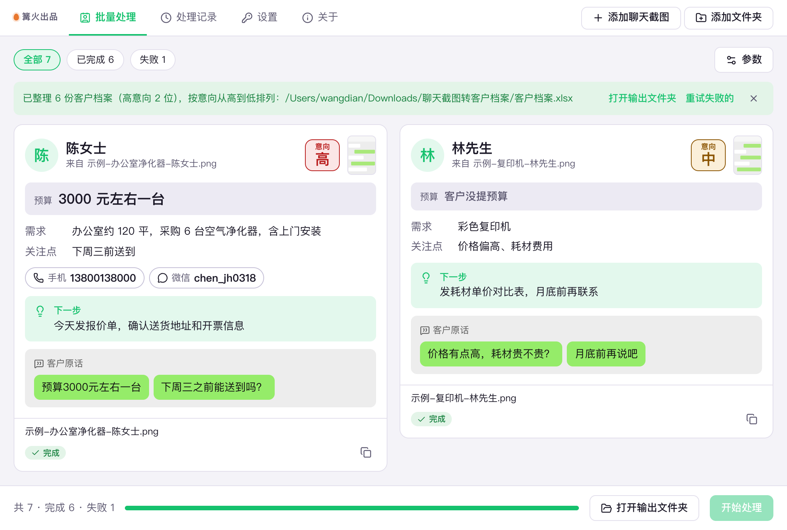

# 聊天截图转客户档案

> 篝火出品 · 收录于篝火 App 应用区

> [!IMPORTANT]
> **只处理已经征得对方同意的聊天内容。** 聊天截图里有对方的称呼、手机号、微信号等个人信息，请遵守《个人信息保护法》等法律法规：征得同意后再收集，导出的档案妥善保管，不再需要时及时删除，不要转卖或泄露。
>
> **数据去向**：文字识别（OCR）在本机完成，截图本身不会上传；整理档案这一步，识别出的文字会发送给你在「设置」里自己配置的大模型服务。默认把手机号中间四位打码后再发送，导出 Excel 时在本机还原完整号码。

批量拖入聊天截图，在本机识别文字，再由大模型整理出客户称呼、需求、预算、意向（高 / 中 / 低 / 未知）、关注点、联系方式和跟进建议，导出一张客户档案 Excel。



## 下载

到 [Releases](https://github.com/campfire-code/chat-screenshot-to-crm/releases/latest) 下载对应安装包：

| 电脑 | 文件 |
|---|---|
| Windows 10 / 11 | `chat-screenshot-to-crm_版本号_windows-x64-setup.exe` |
| Mac（Apple 芯片） | `chat-screenshot-to-crm_版本号_mac-arm64.dmg` |
| Mac（Intel 芯片） | `chat-screenshot-to-crm_版本号_mac-x64.dmg` |

第一次打开：
- **Windows**：如果弹出「Windows 已保护你的电脑」，点「更多信息」→「仍要运行」。
- **Mac**：如果提示「无法验证开发者」，打开「系统设置 → 隐私与安全性」，在下方点「仍要打开」。

## 怎么用

1. 第一次使用先到「设置」填大模型的接口地址、密钥和模型名（兼容 OpenAI 接口格式，例如 DeepSeek、通义千问），点「保存并测试连接」。
2. 把聊天截图拖进窗口（可以拖整个文件夹），支持 png / jpg / jpeg / webp / bmp。每张截图整理成一份档案，同一个客户的多张截图请先拼成一张长图。
3. 确认已征得聊天对方同意后，打开「已征得聊天对方同意」。不打开不会处理。
4. 可选：「我方微信昵称」填你自己在聊天里的名字，帮助区分哪一方是客户。
5. 点「开始处理」。每张截图变成一张客户名片（称呼、意向、预算、需求、联系方式、下一步建议和客户原话），点名片下方的复制按钮可复制整份档案文字。
6. 全部处理完自动生成「客户档案.xlsx」（文件名可改），按意向从高到低排列，「意向」一列按高 / 中 / 低着色。

**怎么防止编造**
- 提示词要求只依据截图文字填写，没有的信息留空，预算照抄客户原话，不估算。
- 手机号、微信号、其他联系方式会和本机识别出的原文逐个核对，原文里没有的直接去掉，并在「提示」列写明。
- 每份档案带「原文依据」（客户原话）和「识别文字」，方便人工复核。大模型的判断仍可能出错，请以原文为准。

**其他说明**
- 识别模型内置（PaddleOCR PP-OCRv4 移动版），离线可用，首张图会稍慢（加载模型）。
- 识别结果是按从上到下的顺序排成的文字，看不出气泡在左边还是右边，所以填「我方微信昵称」会更准。
- 手机号打码只处理中国大陆 11 位手机号（允许中间有空格或横线）。

## 验收用例

示例截图都是虚构内容（标有「示例聊天 · 内容虚构」）。需要先在「设置」里配好大模型；大模型每次的措辞可能略有不同，下表只列确定会出现的结果。

| 操作 | 应得到 |
|---|---|
| 不打开「已征得聊天对方同意」，拖入 `samples/` 整个文件夹，点「开始处理」 | 3 个文件都显示失败，原因是「请先确认已征得聊天对方同意（打开「已征得聊天对方同意」）」，不调用大模型，不生成 Excel |
| 打开「已征得聊天对方同意」，「我方微信昵称」填 `小王（店长）`，点「重试失败的」 | `示例-高意向-办公室净化器.png` 完成，摘要为「陈女士 · 意向：高 · 预算 3000元左右一台」一类；`示例-犹豫-复印机.png` 完成，称呼为林先生，意向为中或低，摘要显示「未提预算」；`示例-损坏文件.png` 失败，原因是「无法识别这张图片，可能已损坏或格式不受支持」 |
| 打开下载目录下「聊天截图转客户档案」文件夹里的 `客户档案.xlsx` | 2 行数据加表头，陈女士在第一行；手机号列是完整的 `13800138000`（发给大模型的是 `138****8000`），微信号列是 `demo_chen01`；林先生那一行手机号、微信号为空 |
| 关闭「手机号打码后再发给大模型」，只处理陈女士的截图 | 结果同上；区别是发给大模型的文字里手机号不打码 |

## 自己编译

需要 Node.js 22、pnpm、Rust。

```bash
pnpm install
pnpm test          # 单元测试
pnpm tauri dev     # 开发运行
pnpm tauri build   # 打包
```

界面框架在 `src/kit`（所有 campfire-code 工具共用），本工具的逻辑在 `src/tool`。

## 致谢

文字识别使用 [PaddleOCR](https://github.com/PaddlePaddle/PaddleOCR) PP-OCRv4 移动版模型（Apache-2.0）的 [RapidOCR](https://github.com/RapidAI/RapidOCR) ONNX 版本（Apache-2.0），由 [ONNX Runtime Web](https://github.com/microsoft/onnxruntime)（MIT）在应用内运行；识别代码取自篝火的 [批量图片 OCR](https://github.com/campfire-code/batch-ocr)。详见 [THIRD_PARTY_LICENSES.md](THIRD_PARTY_LICENSES.md)。

## 归属

本工具由**篝火**出品，是篝火 App 应用区收录的开源工具之一，由篝火（GitHub 组织 [campfire-code](https://github.com/campfire-code)）维护与更新。全部工具的目录见 [toolkit-hub](https://github.com/campfire-code/toolkit-hub)。

## 许可证

MIT，版权方为篝火（campfire-code）。
